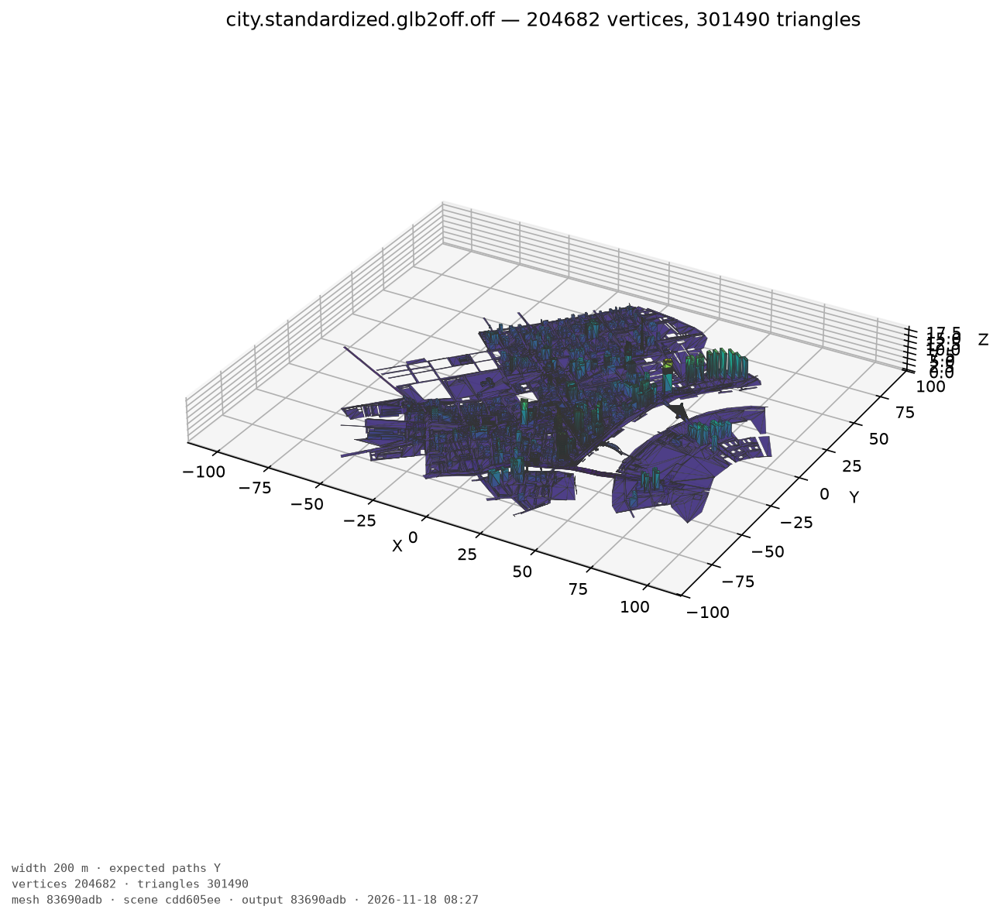
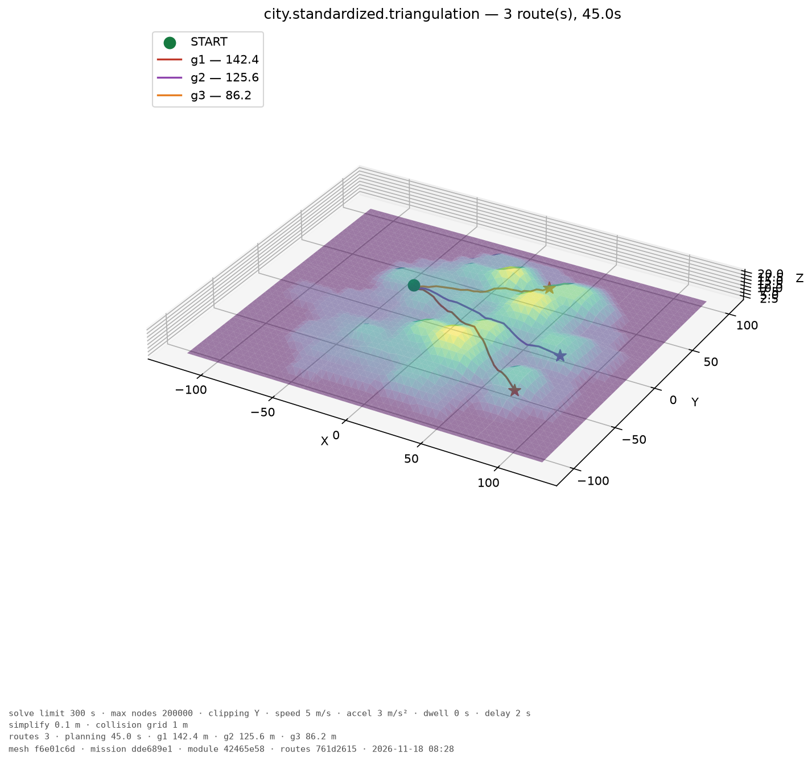
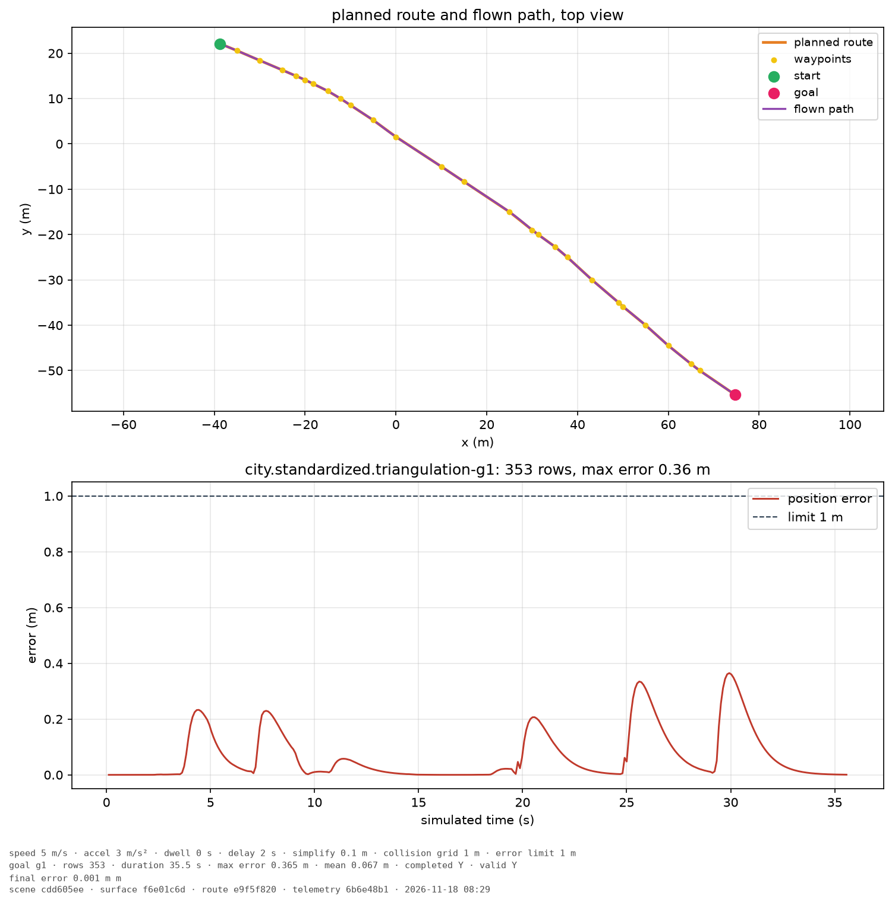

# UAV Funnel Tree — dữ liệu, tuyến và chuyến bay

[](LICENSE)
[](https://www.python.org/)
[](https://gazebosim.org/)
[](docs/tools/docker.md)

Từ scene thành phố thô đến chuyến bay có số đo: dựng bề mặt dẫn đường, lập tuyến
bằng **Funnel Tree**, rồi kiểm chứng tuyến đó có bay được trong Gazebo hay không.

## 1. Giới thiệu

Repo này là phần dữ liệu và kiểm chứng của một nghiên cứu về dẫn đường UAV trên
thành phố. Nó bắt đầu từ `data/raw/scenes/city.glb` (một scene glTF 20 MB) và
chín mesh mẫu, rồi chạy ba stage một chiều:

| Stage | Việc | Thời gian tham khảo |
| --- | --- | --- |
| `data` | Chuẩn hoá scene, dựng **bề mặt envelope**, chọn START/GOAL, vẽ ảnh kiểm tra | ~20 s |
| `plan` | Chạy Funnel Tree cho 10 mission, vẽ tuyến, đối chiếu với đường tham chiếu | 60–90 s |
| `simulate` | Dựng world Gazebo, bay từng tuyến, chấm telemetry | ~40 s mỗi goal |

**Phạm vi và giới hạn.** Thuật toán Funnel Tree chỉ đọc mesh `.off`. Stage
`simulate` là kiểm chứng *tuyến có bay được không*, không phải một phần của
thuật toán: nó đọc route do `plan` sinh ra và không ghi ngược lại gì vào `data/`
hay `generated/routes/`. Repo **không** có benchmark so với thuật toán khác, và
mô hình bay là point-mass có bộ điều khiển PD, không phải mô hình rotor hay
autopilot.

Kết quả định lượng của lần chạy đang lưu: 3 tuyến dài 142,42 / 125,64 / 86,15 m;
ba chuyến bay 35,4 / 33,2 / 24,6 s với sai số bám lớn nhất **0,365 / 1,022 /
0,851 m**; đối chiếu đường tham chiếu **5/5** mesh đạt.

## 2. Ảnh minh hoạ

**Thành phố sau chuẩn hoá** — bản xem dựng từ GLB, tô theo độ cao, có lưới toạ
độ. Ảnh do `tools/data/data_viz.py` sinh, chân ảnh ghi tham số và SHA:



**Ba tuyến trên bề mặt dẫn đường** — nền là envelope tam giác phân (5 m/ô, khe
hở dọc 1,5 m), ba màu là ba goal:



**Kết quả một chuyến bay** — panel trên: tuyến kế hoạch và đường bay thực; panel
dưới: sai số theo thời gian kèm mốc chất lượng 1 m:



Mọi ảnh trong repo đều có ba lớp mô tả: chân ảnh, metadata PNG và sidecar
`<tên>.png.json`. `tools/figures.py` đọc lại cả ba và báo lỗi nếu lệch.

## 3. Tính năng nổi bật

- **Ba stage một chiều, tái lập được**: `data` → `plan` → `simulate`. Route JSON
  ghi SHA256 của mesh, mission và mã thuật toán; `validation.json` ghi SHA của
  route và telemetry, nên một con số luôn truy được về đầu vào sinh ra nó.
- **Bề mặt envelope, không phải địa hình**: lưới 5 m, nâng theo khe hở dọc, mở
  rộng thành dốc; chỉ tồn tại trong hành lang START → GOAL. Chạy lại cho ra
  **đúng byte** cùng một file `.off`.
- **Funnel Tree** với thống kê từng goal: số lần lan truyền (49 / 34 / 21), số
  source, thời gian — đủ để trích vào báo cáo mà không phải đo lại.
- **Ảnh tự mô tả**: tham số + SHA + thời điểm nằm trong chân ảnh, metadata PNG
  và sidecar; có tool kiểm tra chéo.
- **`--fresh` theo từng stage**, không xoá oan: `data` chỉ xoá thứ nó sinh lại,
  `simulate` chỉ xoá thư mục của goal sắp bay.
- **Archive bất biến**: `--label` / `--archive` lưu một lần chạy vào
  `results/runs/<label>/`, không stage nào xoá, `compare_runs.py` in bảng so
  sánh nhiều lần chạy.
- **Hai tiêu chí cho một chuyến bay**: `valid` (bay hết tuyến, dừng đúng đích)
  tách khỏi `passed` (đạt mốc chất lượng 1 m), nên một góc cua trễ không chặn
  cả pipeline.
- **Chạy trên host hoặc trong container**: một image từ nền Gazebo, ba backend
  đồ hoạ (NVIDIA, Intel, llvmpipe), có GUI hoặc `--headless`.
- **Mười mission**: thành phố và chín mesh mẫu (`J17`, `L`, `cliff`, `cube`,
  `demo_mesh`, `dome`, `icosahedron`, `star`, `terrain`).

## 4. Công nghệ sử dụng

| Thành phần | Dùng cho | Phiên bản trong repo |
| --- | --- | --- |
| Python | Toàn bộ pipeline | 3.14.8 trên host; 3.12.3 trong image |
| NumPy | Hình học, lan truyền, kiểm tra | 2.5.4 |
| Shapely | Tam giác phân Delaunay của bề mặt | 2.2.0 |
| Matplotlib | Mọi ảnh PNG | 3.11.2 |
| Pillow | Ghi metadata PNG | 13.0.0 |
| Gazebo Jetty (`gz sim`) | World, vật lý, plugin quỹ đạo | 10.5.0 |
| DART | Engine vật lý, bước 1 ms | theo image Jetty |
| Docker + Compose | Đóng gói và chạy `simulate` | Docker 29.9.1 |
| `glTF 2.0` (`.glb`) | Scene và world visual | — |
| `OFF` | Bề mặt dẫn đường, mesh mẫu | — |

Định dạng trao đổi: JSON (route, mission, validation), CSV (telemetry), PNG
(ảnh có dấu tham số).

## 5. Điều kiện tiên quyết

- **Python 3.12+** cho `data` và `plan` (numpy 2.5.4 yêu cầu 3.12; repo đo bằng
  3.14.8 trên host và 3.12.3 trong image).
- **Docker** nếu chạy `simulate` theo cách mặc định (image Gazebo ~3 GB), hoặc
  **Gazebo Jetty** cài trên máy nếu dùng `--native`.
- **GPU** không bắt buộc: NVIDIA qua CDI, Intel/AMD qua `/dev/dri`, hoặc
  llvmpipe (chậm). Vật lý chạy trên CPU nên số đo không phụ thuộc GPU.
- **Linux** với `bash`; đã đo trên NixOS 26.11 và Ubuntu 24.04 (trong image).
- **Cửa sổ 3D** (`--show`, `--pick`) cần thêm Tk hoặc PyQt6 — xem mục 6.

## 6. Cài đặt

### Trên máy

```bash
python3 -m venv .venv
.venv/bin/pip install -r requirements.txt
```

`main.py` tự dùng `.venv/bin/python` nếu có, ngược lại dùng `python3`.

Cửa sổ 3D (`--show`, `--pick`) cần thư viện hệ thống, pip không cài được:

```bash
# Debian/Ubuntu
sudo apt install python3-tk libzstd1 libxkbcommon0 libgl1 libegl1
# hoặc: .venv/bin/pip install PyQt6   (vẫn cần các lib hệ thống ở trên)

# NixOS: Tk nằm trong site-packages của interpreter Nix, venv không thấy
ln -sf "$(python3 -c 'import sysconfig; print(sysconfig.get_paths()["purelib"])')"/_tkinter*.so \
  .venv/lib/python*/site-packages/

# hoặc dùng PyQt6 trong môi trường FHS
steam-run .venv/bin/python tools/plan/route_viz.py \
  --routes generated/routes/city.standardized.triangulation.routes.json --show
```

Chỉ cửa sổ 3D cần các gói này; chạy stage bằng PNG thì không cần.

### Bằng Docker (không cài Python + Gazebo)

`Dockerfile` dựng một image từ nền Gazebo Jetty (ghim theo digest) và thêm bốn
gói pip pinned. Máy chỉ cần Docker:

```bash
docker compose build pipeline
```

Kiểm tra nhanh sau khi cài:

```bash
python3 main.py flow            # in các stage, lệnh và tham số sẽ hỏi
.venv/bin/python tools/figures.py             # ảnh ↔ tham số, phải 0 lỗi
bash tools/simulate/run_simulate.sh --check   # chỉ khi dùng simulate
```

## 7. Cách sử dụng

### Chạy cả pipeline

```bash
python3 main.py                 # hỏi xoá gì + tham số, rồi data -> plan -> simulate
python3 main.py --no-ask        # không hỏi, dùng mặc định
python3 main.py --fresh         # xoá những gì các stage sẽ sinh lại
python3 main.py data --dry-run  # xem câu hỏi + lệnh, không đổi file nào
python3 main.py --quiet         # ẩn output của tool, chỉ in bước
```

### Chạy một stage

```bash
python3 main.py data            # 7 bước: fixtures, scene, surface, ảnh, mission
python3 main.py plan            # Funnel Tree, ảnh tuyến, đối chiếu reference
python3 main.py simulate        # bay cả g1, g2, g3 rồi chấm
python3 main.py simulate --goal g2 --headless      # một goal, không mở cửa sổ
python3 main.py simulate --goal g3 --gpu software  # không có GPU
```

Stage `data` có bảy bước, dừng ngay khi một bước lỗi:

| # | Lệnh | Vào → Ra |
| --- | --- | --- |
| 1 | `tools/data/copy_meshes.py --write` | `data/raw/meshes/*.off` → `data/processed/meshes/*.off` |
| 2 | `tools/data/standardize.py` | `data/raw/scenes/city.glb` → `scenes/city.standardized.glb` |
| 3 | `tools/data/glb2off.py --force` | `city.standardized.glb` → `meshes/city.standardized.glb2off.off` (bản xem cho báo cáo) |
| 4 | `tools/data/off2glb.py` | `raw/meshes/*.off` → `scenes/meshes/*.off2glb.glb` |
| 5 | `tools/data/triangulation.py --force` | `city.standardized.glb` → `meshes/city.standardized.triangulation.off` |
| 6 | `tools/data/data_viz.py --all` | `processed/meshes/*.off` → `generated/data_viz/*.png` + sidecar |
| 7 | `tools/data/set_start_goal.py --all-meshes --refresh-changed` | bề mặt → `data/processed/missions/<mesh>.mission.json` |

Stage `plan` có ba bước: `run_funnel.py` (missions + `.off` → route JSON),
`route_viz.py` (route → PNG), `compare.py` (route + `data/expected` → đối chiếu).
Stage `simulate` có ba bước: `build_world.py` dựng world, `run_simulate.sh` bay
trong Gazebo, `validate.py` chấm telemetry.

Bước 5 cần `--force` vì tệp đích đã tồn tại; nếu không, tool dừng để tránh ghi
đè ngoài ý muốn. Bước 7 dùng lại lựa chọn START/GOAL đã lưu: mission của mười
mesh đã có trong `data/processed/missions/`, nên chạy lại không hỏi gì. Với mesh
chưa có mission, tool hỏi ngay trong terminal rồi ghi file — chọn xong thì nên
commit file đó, vì `--fresh` không xoá và không sinh lại được lựa chọn ấy.

### Cờ của `main.py`

| Cờ | Tác dụng |
| --- | --- |
| `--fresh` | Xoá đúng những thư mục stage được chọn sẽ sinh lại |
| `--no-ask` | Không hỏi gì, dùng giá trị mặc định |
| `--dry-run` | In câu hỏi và lệnh, không đổi file nào |
| `--quiet` | Ẩn output của từng bước (vẫn in bước lỗi và bảng mốc cuối) |
| `--label NAME` | Chạy rồi lưu kết quả vào `results/runs/NAME/` |
| `--archive NAME` | Chỉ lưu kết quả đang có, không chạy lại |
| `--max-error M` | Mốc chất lượng bám tuyến của `validate` (mặc định 1,0 m) |
| `--mission`, `--goal` | Chọn mission/route của `simulate` (mặc định mọi goal) |
| `--headless`, `--software`, `--show-surface` | Chế độ cửa sổ Gazebo |
| `--container` / `--no-container` | Bay trong image Gazebo hay bằng `gz` trên máy |
| `--image`, `--gpu`, `--keep-open`, `--pull` | Chi tiết phiên Gazebo |
| `--no-png` | Không vẽ ảnh trong `validate` |
| `--all-meshes` / `--no-all-meshes`, `--force-missions` | Phạm vi chọn START/GOAL ở bước 7 |

### Kết quả của lần chạy đang lưu

| Hạng mục | Giá trị |
| --- | --- |
| Bề mặt thành phố | 2.295 đỉnh / 4.400 tam giác / 6.694 cạnh; SHA `f6e01c6d…` |
| Tham số bề mặt | ô 5 m, clearance 1,5 m, half-width 1,6 m, slope 0,5 m/m |
| Mission thành phố | START 792 (−38,752, 22,103) → g1 1810, g2 1910, g3 1518 |
| Tuyến | 142,42 / 125,64 / 86,15 m; 41 / 46 / 40 waypoint |
| Lan truyền | 49 / 34 / 21 lần (tổng 104, 646 source) |
| Bay | 35,4 / 33,2 / 24,6 s; `max_error` 0,365 / 1,022 / 0,851 m |
| `mean_error` | 0,068 / 0,110 / 0,091 m |
| Hợp lệ / mốc 1 m | cả ba `valid`; g2 vượt mốc 2 % tại một góc cua |
| Đối chiếu reference | 5/5 mesh đạt, 5 bỏ qua (không có reference) |

g2 không phải nhiễu: sáu lần bay cho 1,0247 · 1,019 · 1,022 · 1,026 · 1,022 · 1,024 m,
cùng một góc cua (đoạn 8→9, drone chậm 4,9 → 4,2 m/s trong 0,2 s trong khi setpoint
giữ 5,0 m/s). Đó là đặc tính của tuyến, và là lý do `valid` được tách khỏi
`passed`.

### Lưu và so sánh nhiều lần chạy

```bash
python3 main.py --label grid4       # chạy rồi lưu kết quả để so sánh về sau
python3 main.py --archive grid4-b   # chỉ lưu kết quả đang có, không chạy lại
python3 tools/plan/compare_runs.py  # bảng mọi archive đang có
python3 tools/figures.py            # kiểm tra ảnh đã ghi đúng tham số chưa
```

`--fresh` không bao giờ xoá `results/`; archive đã có thì tool từ chối ghi đè.

### Chạy trong container

```bash
FUNNEL_UID=$(id -u) FUNNEL_GID=$(id -g) \
  docker compose run --rm pipeline python3 main.py --no-ask
docker compose run --rm pipeline python3 main.py simulate --goal g1 --headless
```

Compose mount repo vào `/work` nên kết quả vẫn nằm trong `generated/` và
`results/` của bạn. Image đặt `FUNNEL_RUNTIME=native` để `simulate` dùng `gz`
trong image thay vì mở container thứ hai, và `FUNNEL_PYTHON` để không gọi nhầm
`.venv` của host. Ba backend (`pipeline`, `pipeline-intel`,
`pipeline-software`) và cổng kiểm chứng — SHA bề mặt phải trùng bản trên host —
ở [`docs/tools/docker.md`](docs/tools/docker.md).

### Bề mặt dẫn đường

Bề mặt không phải địa hình hay mái nhà: đó là **envelope an toàn** phía trên
thành phố, dựng theo từng ô lưới, nâng lên theo khe hở dọc và mở rộng thành
dốc. Nó chỉ tồn tại trong hành lang giữa START và GOAL:

```bash
# mặc định: hai đầu nhiệm vụ giao hàng
.venv/bin/python tools/data/triangulation.py --force

# nhiệm vụ khác
.venv/bin/python tools/data/triangulation.py --force \
  --start -38.752 22.103 7.206 --goal 74.737 -55.357 7.206 \
  --cell 5 --coverage city --output /tmp/surface.off
```

### Kiểm tra và chọn điểm

```bash
# xem một mesh
.venv/bin/python tools/data/data_viz.py L
.venv/bin/python tools/data/data_viz.py city.standardized.triangulation
```

`set_start_goal.py` đọc mesh, in kích thước và lưới, rồi lấy lựa chọn theo thứ
tự: **file JSON đã lưu → tham số dòng lệnh → hỏi tương tác**. Lựa chọn được lưu
một lần, các lần sau chạy lại chỉ đọc, không hỏi lại.

```bash
.venv/bin/python tools/data/set_start_goal.py              # hỏi và lưu
.venv/bin/python tools/data/set_start_goal.py --pick       # chọn bằng chuột
.venv/bin/python tools/data/set_start_goal.py \
  --start -38.752 22.103 7.206 --goal 74.737 -55.357 7.206  # không tương tác

.venv/bin/python tools/data/set_start_goal.py \
  --mesh data/processed/meshes/cliff.off --start-vertex 1 --all-goals

.venv/bin/python tools/data/set_start_goal.py --force      # chọn lại
.venv/bin/python tools/data/set_start_goal.py --list-meshes
.venv/bin/python tools/data/set_start_goal.py --all-meshes
```

`--pick` (và `--show` của `data_viz`, `route_viz`) cần backend đồ hoạ: cài
`sudo apt install python3-tk` hoặc `pip install PyQt6` trong `.venv`, kèm
`libzstd1 libxkbcommon0 libgl1` (Debian/Ubuntu). Thiếu backend thì `--show` báo
lỗi rõ và dừng; `--pick` tự chuyển sang chọn bằng bàn phím. Chi tiết cờ và
schema JSON ở [`data/processed/README.md`](data/processed/README.md).

## 8. Cấu trúc dự án

```text
main.py                  # chạy stage data / plan / simulate
Dockerfile               # một image: Gazebo + bốn gói pip pinned
docker-compose.yml       # ba backend GPU dùng chung image đó
data/
  raw/                   # nguồn, không sửa tay
  processed/             # đầu vào đã xử lý, sinh lại bằng tools/
  expected/              # đường tham chiếu cho ảnh kiểm tra
tools/
  figures.py             # kiểm tra ảnh ↔ tham số (chân ảnh + sidecar)
tools/data/
  copy_meshes.py         # validate + copy mesh mẫu
  standardize.py         # chuẩn hoá scene GLB
  off2glb.py             # OFF → GLB
  triangulation.py       # dựng + tam giác phân bề mặt
  data_viz.py            # render PNG / cửa sổ 3D
  set_start_goal.py      # chọn START/GOAL, lưu JSON
  glb2off.py             # đọc GLB (duyệt cây node, bake transform) + ghi OFF
tools/plan/
  run_funnel.py          # chạy Funnel cho các mission
  route_viz.py           # routes JSON → PNG
  compare.py             # so độ dài với data/expected
  compare_runs.py        # so nhiều lần chạy đã archive
tools/simulate/
  build_world.py         # dựng world Gazebo + mesh từ một route
  validate.py            # chấm telemetry: sai số bám, tốc độ, hoàn thành
  run_simulate.sh        # bay trong container (hoặc native), chờ kết thúc
  gazebo_system_python.sh  # chạy gz native bằng Python hệ thống
  gui_config.py          # camera + MarkerManager cho phiên GUI
  check_glb.py           # Assimp (Gazebo) có đọc được GLB không
  plugin/                # trajectory + bộ điều khiển chạy trong Gazebo
algo/
  funnel_tree.py         # lan truyền, dựng lại tuyến, tìm source
lib/
  mesh_glb.py            # container GLB
  mesh_off.py            # đọc/ghi OFF + lớp Mesh (kề, góc, khoảng cách)
  plotting.py            # chọn backend cửa sổ, báo lỗi rõ khi thiếu
  figstamp.py            # chân ảnh + PNG tEXt + sidecar .png.json
generated/               # đầu ra của lần chạy gần nhất
results/
  runs/                  # bản lưu từng lần chạy (--label), không bị xoá
docs/
  data-format.md         # quy ước định dạng
  tools/                 # mỗi tool một file: vào/ra, thuật toán, giới hạn
```

`lib/` không phải package: các module được import theo tên sau khi thêm `lib/`
vào `sys.path`, xem [`lib/README.md`](lib/README.md).

### Đầu ra của stage `data`

| Tệp | Nội dung |
| --- | --- |
| `data/processed/meshes/*.off` | Chín mesh mẫu, copy byte-identical từ `data/raw/meshes/` |
| `data/processed/scenes/city.standardized.glb` | Scene thành phố đã bake transform, bỏ material |
| `data/processed/scenes/meshes/*.off2glb.glb` | Mesh mẫu ở dạng GLB Y-up để mở bằng viewer |
| `data/processed/meshes/city.standardized.triangulation.off` | Bề mặt dẫn đường 2.295 đỉnh / 4.400 tam giác |
| `generated/data_viz/*.png` | Ảnh kiểm tra từng mesh, kèm đường tham chiếu |
| `data/processed/missions/<mesh>.mission.json` | START/GOAL đã chọn cho từng mesh |

### Đầu ra của stage `plan`

| Tệp | Nội dung |
| --- | --- |
| `generated/routes/<mission>.routes.json` | Waypoint từng tuyến, độ dài, hash mesh/mission/mã thuật toán, tham số và thời gian chạy |
| `generated/routes/<mission>.routes.png` | Ảnh bề mặt + các tuyến |
| `generated/compare/<mesh>.compare.json` | So từng đỉnh với `data/expected/<mesh>.paths.json` |
| `generated/compare/summary.json` | Mesh nào đạt, không đạt, bị bỏ qua |

### Đầu ra của stage `simulate`

| Tệp | Nội dung |
| --- | --- |
| `generated/simulate/<mission>-<goal>/city.sim.glb` | Bản visual của thành phố trong world đó (có `NORMAL` để Gazebo tô sáng) |
| `generated/simulate/<mission>-<goal>/city.sim.collision.stl` | Bản collision đã decimate theo `--collision-grid` |
| `generated/simulate/<mission>-<goal>/funnel_physics.sdf`, `flown_route.json` | World và tuyến đã rút gọn mà plugin thực sự bay |
| `generated/simulate/<mission>-<goal>/physics_telemetry.csv` | Telemetry từng bước: `sim_time`, vị trí, setpoint, `error`, `phase` |
| `generated/simulate/<mission>-<goal>/validation.json` | `max_error`, `mean_error`, `final_error`, `valid`, `passed` |
| `generated/simulate/<mission>-<goal>/tracking.png` + `.png.json` | Ảnh tuyến + sai số theo thời gian, có dấu tham số |
| `results/runs/<label>/` | Bản lưu của một lần chạy (`--label` / `--archive`), không stage nào xoá |

`valid` và `passed` trả lời hai câu khác nhau; xem
[`docs/tools/simulate/validate.md`](docs/tools/simulate/validate.md).

### Định dạng

- `.off`: lưới tam giác văn bản, `OFF` + `V F E` + đỉnh + mặt.
- `.glb`: glTF 2 nhị phân; scene chuẩn hoá giữ Y-up, mesh dẫn xuất dùng Z-up.
- `.paths.json`: đường tham chiếu cho ảnh kiểm tra.

Quy ước chi tiết ở [`docs/data-format.md`](docs/data-format.md); mỗi tool một
file mô tả thuật toán ở [`docs/tools/`](docs/tools/README.md).

### Lưu trong Git

- Commit: dữ liệu `raw/`, đầu ra `processed/` (kể cả `missions/*.json`), mã
  nguồn, tài liệu, kết quả `plan` (`generated/routes/**`,
  `generated/compare/**`).
- Commit cả `generated/simulate/**` và `results/runs/**` của những chuyến bay
  đang dùng làm bằng chứng: telemetry và `validation.json` chỉ sinh lại được khi
  có Docker + image Gazebo + GPU, nên để trong Git thay vì chỉ trên một máy.
- Commit `generated/data_viz/**` và `generated/routes/**` (PNG): mỗi ảnh mang
  chân tham số + SHA và được dẫn trực tiếp trong báo cáo. Ảnh có timestamp nên
  chạy lại stage là diff đổi; chỉ commit lại khi tham số hoặc mesh đổi.
- Commit `data/processed/scenes/city.standardized.glb`: `triangulation` đọc nó
  và SHA của nó nằm trong `surface.params.json`, nên giữ file để đối chiếu.
- Không commit: `.venv/`, `__pycache__/`, `generated/parameters.json` (mỗi run
  ghi đè), và log khác ngoài `generated/simulate/*/gazebo.log`.

Chạy lại stage `data` phải cho ra đúng byte của
`data/processed/meshes/city.standardized.triangulation.off`. Nếu khác, ghi lại
SHA cũ/mới và lý do trong `data/processed/README.md` trước khi commit.

## 9. Đóng góp

1. **Kết quả phải tái lập được.** Thêm số liệu mới thì thêm script sinh ra nó,
   kèm lệnh chạy và tham số; kết quả ngoại tuyến không được diễn giải thành kết
   quả Gazebo. Cách ghi và cách đọc lại ở
   [`docs/tools/reproducibility.md`](docs/tools/reproducibility.md) và
   [`results/README.md`](results/README.md).
2. **Không đổi hình học mà không ghi lại.** Bề mặt là mốc so sánh: sửa mã dẫn
   đến SHA khác thì ghi SHA cũ/mới và lý do.
3. **Ảnh luôn đi qua `lib/figstamp.py`**, để ba lớp (chân ảnh, metadata, sidecar)
   luôn khớp; chạy `tools/figures.py` trước khi commit.
4. **Một lần chạy = một archive.** Muốn giữ số liệu thì `--label`, không sửa
   tay file trong `results/runs/`; muốn cấu hình khác thì chạy label mới.
5. **Câu hỏi trên terminal phải là dòng riêng** (`write()` + `\n`), không truyền
   vào `input(prompt=...)`: `main.py` chuyển output theo dòng nên prompt không
   xuống dòng sẽ bị giữ trong pipe và tool trông như treo.
6. **Mỗi tool một tài liệu** trong `docs/tools/`, mô tả vào/ra, cờ, thuật toán
   và giới hạn — đủ để trích khi viết báo cáo.

Kiểm tra trước khi gửi thay đổi:

```bash
.venv/bin/python tools/figures.py        # ảnh ↔ tham số
python3 tools/plan/compare_runs.py       # các archive còn đọc được
python3 main.py data --dry-run           # lệnh và tham số của stage
```

## 10. Giấy phép

Mã nguồn theo **BSD-3-Clause** — xem [`LICENSE`](LICENSE). Giấy phép này chỉ
áp dụng cho phần mã của nhóm; dữ liệu, mô hình và thư viện bên thứ ba giữ nguyên
điều khoản gốc của chúng. Nguồn, giấy phép và trục toạ độ của từng tệp dữ liệu ở
[`ATTRIBUTION.md`](ATTRIBUTION.md) và [`data/README.md`](data/README.md).

## 11. Tác giả và liên hệ

| | |
| --- | --- |
| **Đỗ Lê Chí Kiên** | [@kienakalo](https://github.com/kienakalo) · doleckien@gmail.com |
| **Nguyễn Trương Đăng Quang** | [@quangnguyen0101](https://github.com/quangnguyen0101) |
| Đơn vị | Ho Chi Minh City University of Technology (HCMUT) |

Câu hỏi về số liệu, cách tái lập hoặc lỗi trong pipeline: mở issue trên
[GitHub](https://github.com/kienakalo/uav-funnel-tree-gazebo/issues). Khi báo
lỗi, gửi kèm `generated/parameters.json`, commit đang chạy và file
`validation.json` liên quan.
